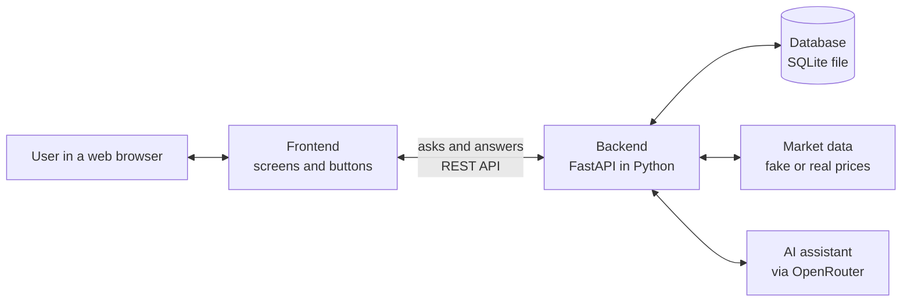
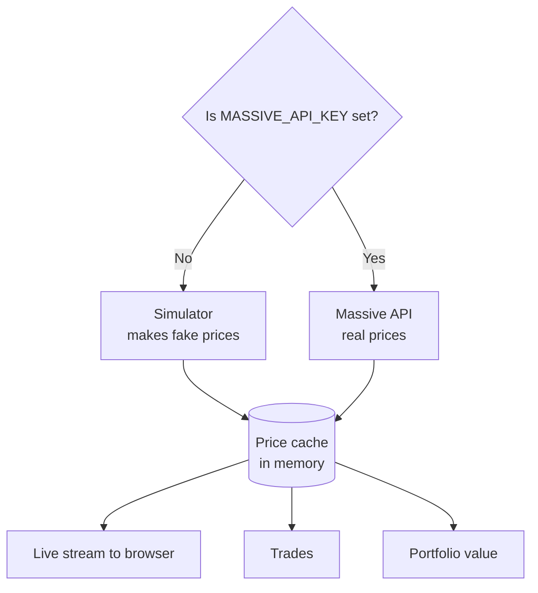
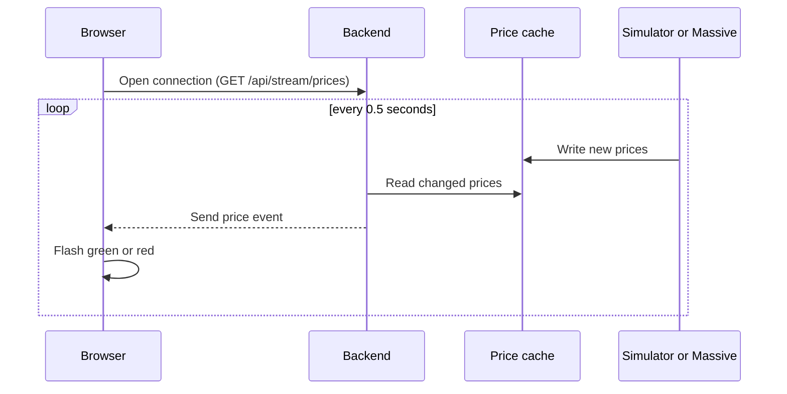
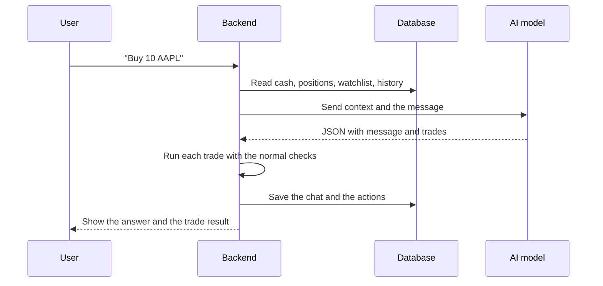
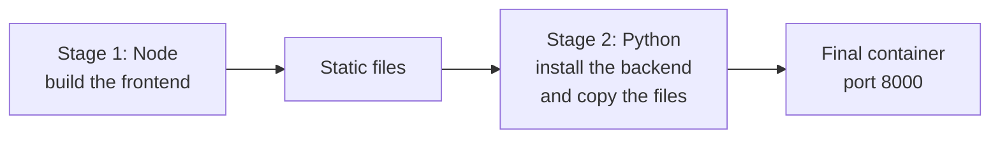

# Understanding FinAlly

This document explains how the FinAlly project works. It is for readers who are new to system design. It uses short sentences and simple words. Each term is explained the first time it appears.

**Status of the project:** Today the project has two documents: `PLAN.md` and `MARKET_DATA_DESIGN.md`. The application code is not written yet. This document explains the system as it is planned.

---

## 1. What is FinAlly?

FinAlly is a trading practice app. It runs in a web browser.

- The user gets $10,000 of fake money.
- The user sees stock prices that change all the time.
- The user can buy and sell shares. No real money is used.
- The user can talk to an AI assistant. The assistant can also buy and sell for the user.

A **stock** is a small part of a company. A **share** is one unit of a stock. A **ticker** is a short code for a stock. For example, `AAPL` is the ticker for Apple.

A **portfolio** is everything the user owns: the cash and the shares.

---

## 2. The big picture

The system has two main parts.

1. The **frontend**. This is what the user sees in the browser.
2. The **backend**. This is a program that runs on a computer. The user does not see it.

The frontend asks the backend for data. The backend answers. The backend also stores data in a **database**. A database is a place where a program keeps information so it does not get lost.



The whole system runs in **one container**. A container is a sealed box. The box holds the program and everything the program needs. The program works the same way on every computer. The tool that makes and runs the box is called **Docker**.

The box uses **one port**: port 8000. A port is a numbered door on a computer. The user opens `http://localhost:8000` and sees the app.

---

## 3. The parts, one by one

### 3.1 Frontend

The frontend is built with **Next.js** and **TypeScript**. It is built one time and saved as plain files (HTML, CSS, JavaScript). The backend then gives these files to the browser.

The frontend shows these items:

| Item | What it shows |
|---|---|
| Watchlist | A list of tickers with live prices. A price flashes green when it goes up. It flashes red when it goes down. |
| Sparkline | A very small chart next to each ticker. |
| Main chart | A large chart for the ticker the user selects. |
| Heatmap | Colored boxes. Each box is a stock the user owns. A large box means a large part of the portfolio. Green means profit. Red means loss. |
| P&L chart | A line chart of the total portfolio value over time. P&L means "profit and loss". |
| Positions table | A table of the stocks the user owns. |
| Trade bar | Two buttons: Buy and Sell. |
| Chat panel | A place to talk to the AI assistant. |
| Header | The total value, the cash, and a colored dot that shows the connection status. |

The dot is green when the connection is good. It is yellow when the app tries to connect again. It is red when there is no connection.

### 3.2 Backend

The backend is built with **FastAPI**. FastAPI is a Python tool for making web servers. A **server** is a program that waits for requests and sends answers.

The backend does five jobs:

1. It gives the frontend files to the browser.
2. It answers requests from the frontend (the **API**).
3. It keeps the live prices.
4. It reads and writes the database.
5. It talks to the AI assistant.

An **API** is a set of rules. The frontend follows these rules to ask the backend for things. **REST** is a common style of API. Each request has a path and a method.

| Method | Meaning |
|---|---|
| GET | Read data. |
| POST | Send new data. |
| DELETE | Remove data. |

Examples from the plan:

- `GET /api/portfolio` returns the cash, the positions, and the total value.
- `POST /api/portfolio/trade` buys or sells a stock.
- `POST /api/watchlist` adds a ticker.
- `POST /api/chat` sends a message to the AI.
- `GET /api/health` tells if the system is alive.

### 3.3 Database

The database is **SQLite**. SQLite keeps all data in one file: `db/finally.db`. It needs no extra server. This is good for an app with one user.

The database has six **tables**. A table is like a sheet in a spreadsheet.

| Table | What it stores |
|---|---|
| `users_profile` | The cash balance. |
| `watchlist` | The tickers the user watches. |
| `positions` | The shares the user owns now. |
| `trades` | A list of every buy and sell. The program only adds to this list. It never changes old rows. |
| `portfolio_snapshots` | The total value at many points in time. The P&L chart uses this. |
| `chat_messages` | The chat history. |

The database starts empty. At the first start, the backend creates the tables and adds the starting data: $10,000 and 10 tickers. This is called **lazy initialization**. The user does not set up anything.

A Docker **volume** keeps the database file outside the box. When the box stops, the data stays safe.

### 3.4 Market data (the price system)

The app needs prices. There are two sources. The app uses only one of them at a time.



**Simulator.** The simulator makes fake prices. It is the default. It needs no key and no internet. It changes the prices two times each second. It uses a math model named **geometric Brownian motion**. This model makes a price move up and down by small random steps. Some stocks move together, like tech stocks. Sometimes a stock jumps 2% to 5% for drama.

**Massive API.** Massive is a company that sells real market data. The user gives a key in the `.env` file. The backend then asks Massive for prices. It asks one time every 15 seconds. A free key allows 5 requests each minute. For this reason the app asks for all tickers in one request.

**Same shape for both.** Both sources follow the same rules (the **interface**). The rest of the app does not know which source is active. This is a good design habit. You can change one part without a change to the other parts.

**Price cache.** A **cache** is a fast memory place. The price cache holds the latest price of each ticker. The sources write to it. All other parts read from it.

### 3.5 Live prices to the browser (SSE)

A normal request works like this: the browser asks, the server answers, and it stops. Prices change all the time. The browser cannot ask 100 times each minute.

The plan uses **SSE** (Server-Sent Events). The browser opens one connection and keeps it open. The server sends new prices through it when they change. Data goes in one direction only: from server to browser.



If the connection breaks, the browser connects again by itself.

The plan chose SSE and not **WebSockets**. WebSockets send data in both directions. The app does not need that. SSE is simpler.

### 3.6 Trading

A **market order** buys or sells at the current price, at once. The app has no other order type. This keeps the math simple.

**Buy steps:**

1. The user enters a ticker and a quantity. The user pushes Buy.
2. The backend reads the current price from the price cache.
3. The backend checks that the user has enough cash.
4. The backend subtracts the cash. It adds the shares to `positions`.
5. The backend writes a row to `trades`.
6. The backend saves a snapshot of the total value.

**Sell steps** are the same. The backend checks that the user owns enough shares. It adds cash and removes shares.

If a check fails, the backend sends an error. Nothing changes.

**Unrealized P&L** is the profit or loss on shares that the user still holds. The formula is:

```
unrealized P&L = (current price - average cost) x quantity
```

### 3.7 AI assistant

The assistant is called "FinAlly". The backend uses **LiteLLM** to talk to **OpenRouter**. OpenRouter gives access to many AI models. The plan uses a free model: NVIDIA Nemotron.

The AI does not give free text only. It gives **structured output**. This is data in a fixed shape (JSON). The backend can read it with no doubt. The shape is:

```json
{
  "message": "I bought 10 shares of AAPL for you.",
  "trades": [{"ticker": "AAPL", "side": "buy", "quantity": 10}],
  "watchlist_changes": [{"ticker": "PYPL", "action": "add"}]
}
```

**Chat steps:**



The backend runs the trades from the AI without a confirmation. This is a design choice. The money is fake, so the risk is zero. The AI trades must pass the same checks as manual trades.

**Mock mode.** If `LLM_MOCK=true`, the backend does not call the AI. It sends fixed answers. Tests use this mode. It is fast and free, and the result is always the same.

---

## 4. A full example: what happens when the user starts the app

1. The user runs one Docker command (or a start script).
2. Docker starts the container.
3. FastAPI starts. It reads the `.env` file.
4. The backend opens the database. If the database is new, it creates the tables and the starting data.
5. The backend reads the watchlist from the database.
6. The backend selects a price source. It starts the source.
7. The source writes prices to the cache.
8. The user opens `http://localhost:8000`.
9. The browser receives the frontend files.
10. The frontend opens the SSE connection. Prices start to arrive.
11. The frontend asks `GET /api/portfolio` and `GET /api/watchlist`. The screen fills with data.

---

## 5. Background work

Some work runs with no user action. These are **background tasks**.

| Task | Time | Purpose |
|---|---|---|
| Price source | Every 0.5 s (simulator) or 15 s (Massive) | Update the price cache. |
| Snapshot task | Every 30 s | Save the total portfolio value for the P&L chart. |

---

## 6. Settings (environment variables)

An **environment variable** is a setting that lives outside the code. The `.env` file holds them. The file is not saved in Git, because it holds secret keys.

| Name | Purpose |
|---|---|
| `OPENROUTER_API_KEY` | The key for the AI service. |
| `MASSIVE_API_KEY` | The key for real prices. Leave it empty to use the simulator. |
| `LLM_MOCK` | Set to `true` for fake AI answers. |

---

## 7. Folder map

```
finally/
  frontend/     The browser app (Next.js)
  backend/      The server (FastAPI, Python)
    db/         Table definitions and starting data
  planning/     The documents (this file is here)
  scripts/      Start and stop scripts
  test/         End-to-end tests (Playwright)
  db/           The database file, at run time
  Dockerfile    The recipe for the container
  .env          Secret settings
```

---

## 8. How the container is built

The Dockerfile has two stages.



Stage 1 builds the frontend into plain files. Stage 2 builds the backend. It copies the plain files into it. The final box has only what it needs to run.

---

## 9. How the project is tested

| Test type | What it checks | Where |
|---|---|---|
| Unit tests | One small part, alone (price math, trade rules). | `backend/`, `frontend/` |
| End-to-end tests | The full app in a real browser, like a user. | `test/` |

The end-to-end tests use a tool called **Playwright**. It controls a browser by code. These tests use mock AI mode.

---

## 10. Design choices and the reasons

| Choice | Reason |
|---|---|
| One container, one port | The user runs one command. There is nothing else to set up. |
| Static frontend, served by the backend | One origin. No CORS problems. (CORS is a browser safety rule for requests between different sites.) |
| SQLite | One user needs no database server. |
| SSE, not WebSockets | The app needs only server-to-browser data. |
| Market orders only | No order book. The math stays simple. |
| Simulator by default | The app works with no key and no internet. |
| One shared interface for price sources | You can change the source with no change to the other code. |
| `user_id` column in each table | The app can support many users later. No big change is needed. |

---

## 11. Short glossary

| Term | Meaning |
|---|---|
| API | Rules that let one program ask another program for data. |
| Backend | The program that runs on the server. |
| Cache | A fast memory place for data that is used often. |
| Container | A sealed box that holds a program and what it needs. |
| Database | A place to store data in an ordered way. |
| Endpoint | One path of an API, for example `/api/portfolio`. |
| Frontend | The part the user sees in the browser. |
| JSON | A text format for data. It uses names and values. |
| LLM | Large Language Model. An AI that reads and writes text. |
| Polling | Asking again and again, at fixed times, for new data. |
| Portfolio | The cash and shares that the user owns. |
| SSE | A way for a server to push data to a browser. |
| Ticker | A short code for a stock, for example `AAPL`. |
| Volume | Storage outside a container. The data stays when the container stops. |

---

## 12. What to learn next

1. Read `PLAN.md`. It is the main specification.
2. Read `MARKET_DATA_DESIGN.md`. It shows the price system in code.
3. Try to draw the buy flow by hand, from memory.
4. Ask: "What happens if the Massive API is slow?" The answer: the old prices stay in the cache.
